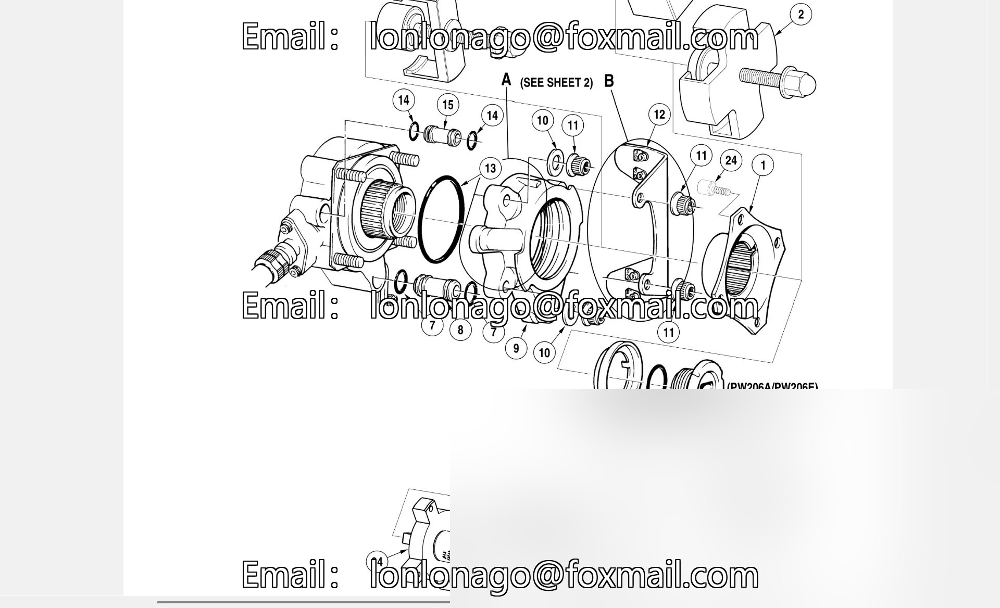
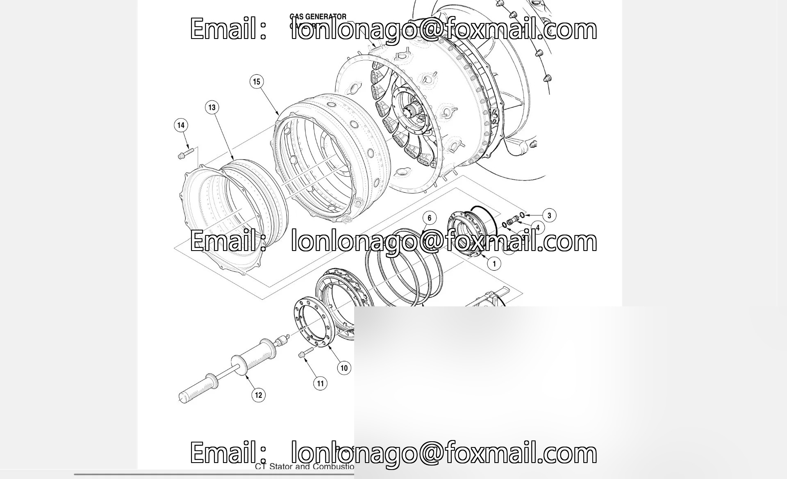
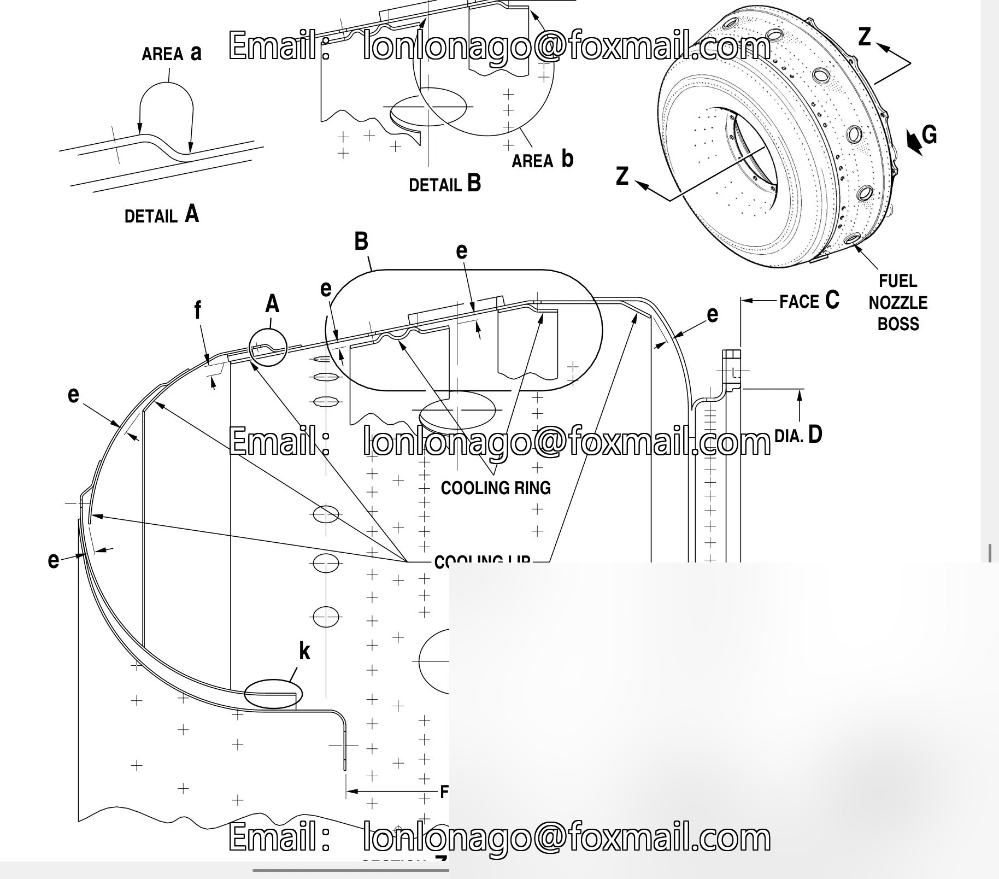
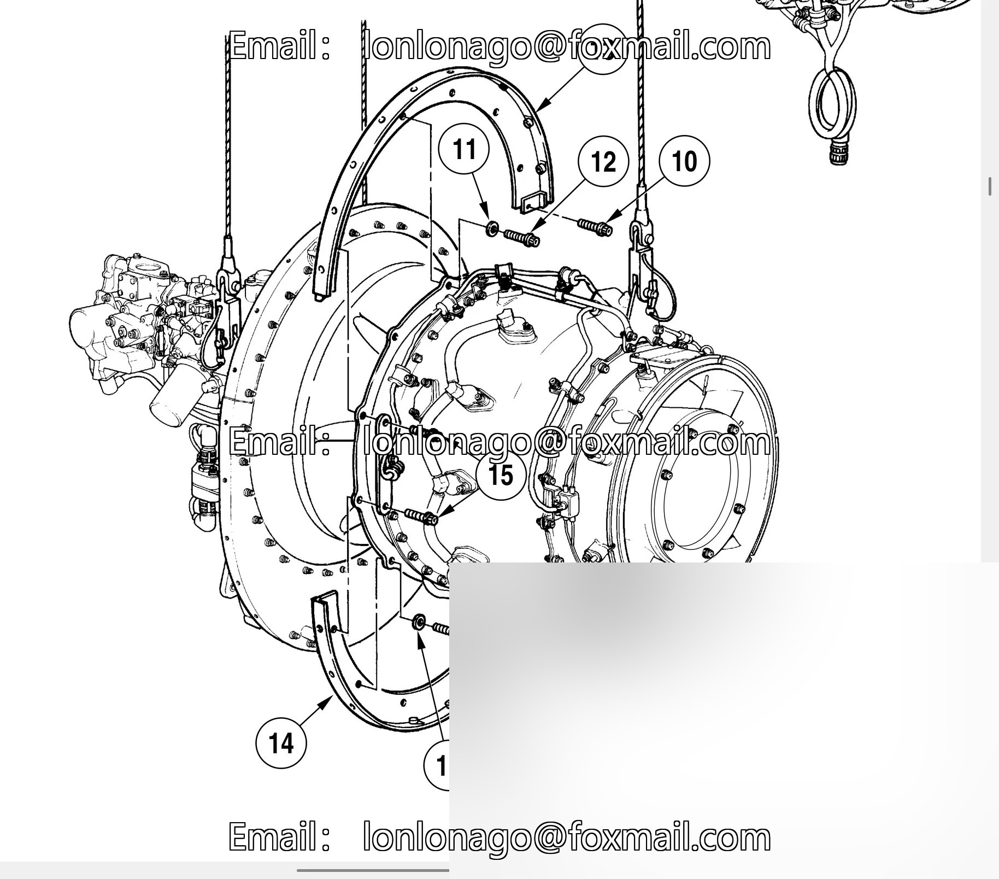
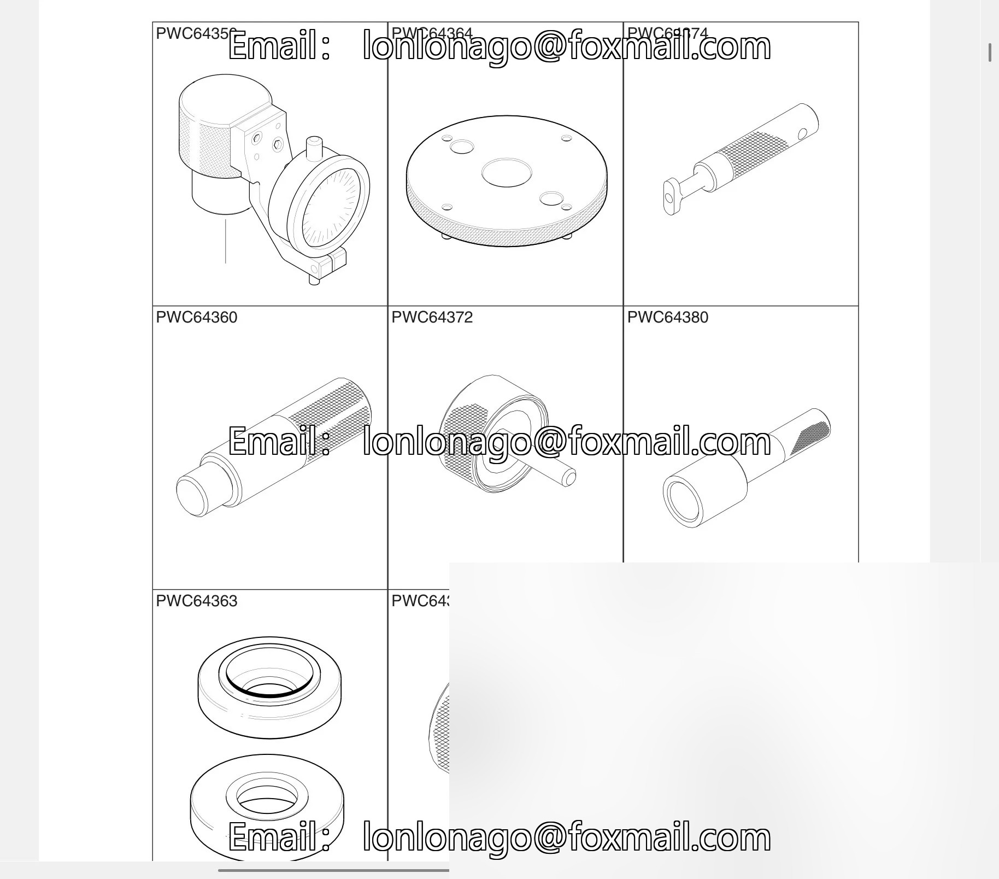

# Pratt & Whitney Canada (P&WC) PW206A/E and PW2

## Body

The official Maintenance Manual, 1,750 pages, of the Pratt & Whitney Canada Company (P&WC) PW206A/E and PW207E axial engine.
Applicable specific subjects: The manual applies to three P&WC-produced axial engine models:

PW206A (Configuration Specification 752)

PW206E (Configuration Specification 934)

PW207E (Configuration Specification 1035)
These engines are usually used for medium and small-sized helicopters, such as the Lionel Leona AW109 series, Bell 429 models, etc.
Including structure diagrams, part diagrams, maintenance manuals, etc., the content is complete, suitable for aviation engine maintenance, design, and learning reference.
The materials are , no return after sale. If direct shooting is needed, contact privately for issues.

The materials cover the P&WC PW206A/E and PW207E axial engine maintenance manual, with structural drawings, part diagrams and maintenance manuals, offering complete content for aviation engine repair, design and learning reference.

<!-- AI_ENRICHED -->

## Images

## Payment

Here is a pay link on Stripe ( https://buy.stripe.com/3cs8yP7sY87d0vu9AB ). Please contact me lonlonago@foxmail.com after funding $89, and I will send you a complete data files , thank you!

